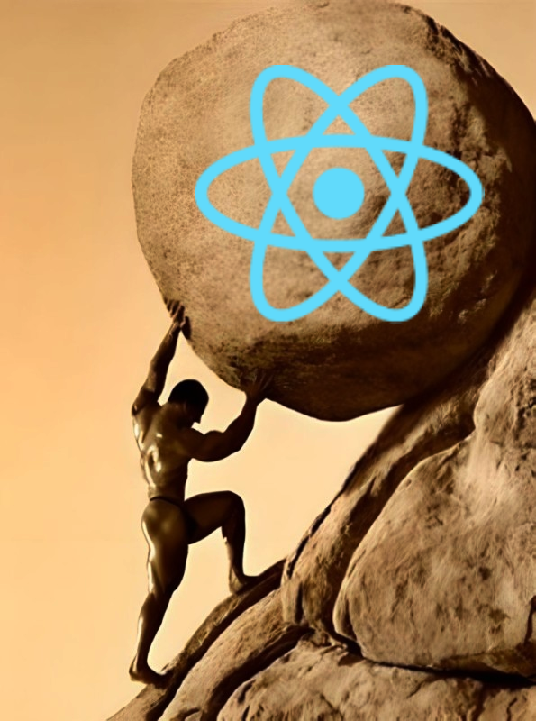

# Лабораторная работа №1

## Информация

*ФИО*: Вахитов Равиль Фаизович

*Группа*: 6402-010302D

*Научный руководитель*: Котов Антон Петрович

> ### «Одной борьбы за вершину достаточно, чтобы заполнить сердце человека. Сизифа следует представлять себе счастливым.»
>
> ### *Альбер Камю, "Миф о Сизифе"*

---

# Лабораторная работа №2

## Тема
Изучение основ HTML и CSS. Разработка многостраничного веб-сайта на тему каталога рипов додзин-музыки (**DoujinMusicDB**).

## Описание проекта
Сайт представляет собой каталог-базу данных рипов японской независимой музыки, вдохновленный сообществами **Doujin Music** в VK и Telegram. В отличие от стандартной ленты соцсетей и мессенджеров, веб-каталог позволяет структурировать релизы по тегам (`#тег`) и кружкам/авторам (`@кружок`).

## Структура сайта (`lab2/`)
- `index.html` — главная страница: поисковая панель с подсказкой синтаксиса (`#тег`, `@кружок`), сетка карточек релизов со ссылками на альбомы.
- `album.html` — страница «Случайный альбом» (релиз *Foreground Eclipse — Stories That Last Through The Sleepless Nights*): обложка релиза, метаданные, теги, ссылка на оригинальный пост в VK и таблица треклиста.
- `about.html` — страница с описанием проекта, информацией о сообществе и ссылками на социальные сети.
- `css/style.css` — подключаемая каскадная таблица стилей в темной теме.
- `images/` — изображения обложек альбомов (`cover.jpg`, `cover2.jpg`, `cover3.jpg`, `cover4.jpg`).
